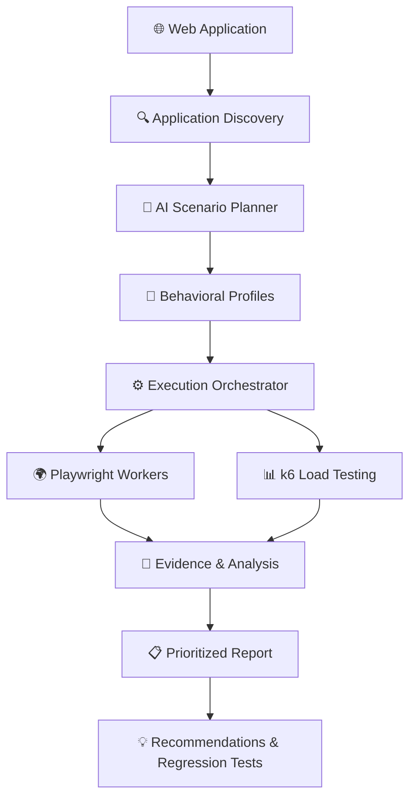

# Tracewise

**Find the bugs your test suite doesn't know to look for.**

Tracewise is an open-source, AI-powered testing CLI that explores web applications like real users. It uses different behavioral profiles to discover unexpected bugs, test user workflows, and evaluate backend performance.

## How It Works

## What We're Building

- **AI Exploration** — Discover application workflows and simulate different user behaviors.
- **Bug Discovery** — Identify functional errors, unexpected behavior, and usability problems.
- **Performance Testing** — Simulate concurrent users and analyze backend performance.
- **Smart Reports** — Rank findings by severity, provide evidence, and suggest improvements.
- **Cost Tracking** — Monitor LLM token usage and estimated API costs using your own API key.

## Technology Stack

| Component | Technology |
|---|---|
| Language & CLI | Python · Typer |
| Browser Automation | Playwright |
| Load Testing | Grafana k6 |
| AI Integration | LLM Provider APIs |
| Validation | Pydantic |
| Storage | SQLite |
| Reports | HTML · JSON · Markdown |

## Project Status

🚧 **Early development — not ready for production use.**

We're building Tracewise incrementally, starting with web application discovery and AI-assisted exploratory testing.

## Documentation

See [guide.md](./guide.md) for the complete project vision, architecture, technical decisions, development roadmap, and contributor guidelines.

## Contributing

Tracewise is an open-source project, and contributions are welcome. Ideas, bug reports, discussions, documentation improvements, and code contributions are all appreciated.

Let's make application testing smarter.

## License

To be determined.