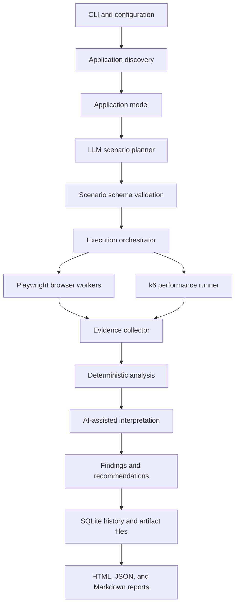

# Project Guide: Local-First AI Application Testing CLI

**Document type:** Project vision, architecture, MVP specification, and contributor guide  
**Status:** Draft for the initial open-source development phase  
**Last updated:** 5 November 2026  
**Project name:** To be selected  
**Initial platform:** Web applications  
**Execution model:** Hybrid AI planning + deterministic workers  
**Distribution model:** Local-first CLI; developers use their own LLM API keys

---

## 1. Executive Summary

This project aims to build an open-source command-line tool that helps developers discover problems in web applications before real users encounter them.

A developer points the CLI at a running web application. The tool inspects the application, builds a map of its pages and interactive elements, and uses an LLM to propose realistic user journeys. Controlled browser workers then execute those journeys, collect evidence, and identify possible functional and usability problems. A separate performance engine can run approved API load scenarios and report how the backend behaves under a defined workload.

The final report should do more than list errors. It should rank findings by impact, distinguish confirmed failures from possible concerns, show evidence, provide reproduction steps, recommend next actions, and record LLM token usage and estimated API cost.

The tool is **local-first**. By default, project analysis, browser automation, test history, screenshots, traces, and reports stay on the developer's machine. The developer supplies their own LLM API key. The tool should not require a hosted account or a central application backend to perform its core work.

### 1.1 Product statement

> Find the bugs your existing test suite does not know to look for.

The project combines application discovery, AI-assisted exploratory testing, repeatable browser execution, controlled performance testing, evidence collection, and developer-friendly reporting.

### 1.2 The problem we are solving

Traditional automated tests are valuable, but developers must decide which scenarios to write. Important edge cases can remain untested: repeated submissions, unusual navigation, expired sessions, conflicting actions, confusing workflows, or unexpected combinations of user behavior.

This project aims to help discover those missing scenarios. It is not intended to replace unit tests, integration tests, Playwright tests, security specialists, or established load-testing tools. It should work alongside them.

---

## 2. Vision, Goals, and Non-Goals

### 2.1 Long-term vision

Grow from a reliable web application exploratory-testing CLI into an extensible application quality platform that can:

- Understand applications and their main user journeys.
- Explore applications using diverse, configurable user behavior profiles.
- Find and explain functional, workflow, usability, accessibility, and selected application-level security problems.
- Reproduce findings reliably and turn approved discoveries into regression tests.
- Generate controlled API performance workloads and explain the results.
- Compare runs over time to identify regressions.
- Integrate into developer workflows and CI/CD pipelines.
- Add mobile automation through a separate adapter when the web foundation is stable.
- Optionally support remote or distributed execution in a later phase without making cloud infrastructure mandatory.

### 2.2 Version 1 goals

The first release should prove five things:

1. It can understand a real, running web application well enough to map reachable pages and interactive elements.
2. It can generate valid user scenarios from that application model.
3. It can execute those scenarios reliably with isolated browser sessions.
4. It can report useful, evidence-backed findings instead of unverified AI guesses.
5. It can run a small, explicit, approved API load test through an established load-testing engine.

Token usage and estimated LLM cost tracking should be present from the first LLM integration.

### 2.3 Non-goals for the first release

The MVP will not attempt to:

- Run hundreds of independent LLMs or hundreds of full browser instances on one laptop.
- Support native Android and iOS apps.
- Replace a complete security audit or penetration test.
- Automatically change application source code or open pull requests.
- Execute arbitrary shell commands or Python generated by an LLM.
- Load-test arbitrary third-party or production systems by default.
- Provide a hosted dashboard, central account system, or cloud service.
- Support every LLM provider on day one.
- Guarantee that every defect will be discovered.

Keeping these boundaries is important. The first product should be useful and dependable, not a large collection of unfinished features.

---

## 3. Core Product Principles

### 3.1 AI plans; controlled software executes

An LLM can reason about the application and propose test scenarios. It must not have unrestricted control over the operating system, shell, browser, network, or project files.

The planner returns structured data. The scenario validator checks it. The execution engine accepts only supported actions and runs them with strict limits.

### 3.2 Evidence before claims

A timeout or an LLM statement is not automatically a bug. Findings should be based on observable evidence such as failed assertions, browser errors, HTTP responses, screenshots, traces, or repeatable behavior.

Every finding should state whether it is:

- **Confirmed:** Reproduced or supported by deterministic evidence.
- **Suspected:** Plausible, but not yet sufficiently reproduced.
- **Recommendation:** An improvement rather than a demonstrated defect.

Severity and confidence must be separate fields.

### 3.3 Deterministic execution where possible

DOM inspection, navigation, locator resolution, assertions, event collection, metrics aggregation, and report formatting should be deterministic. Use LLM reasoning only when it adds value, such as interpreting application intent or designing a new scenario.

### 3.4 Local-first and privacy-aware

The developer should control the target application, API keys, test data, and evidence. External LLM calls should be visible and configurable. Reports and traces must not silently expose secrets or personal data.

### 3.5 Small, composable modules

The project should be a modular monolith at the beginning. Keep clear boundaries between the core data models and the integrations for Playwright, k6, LLM providers, storage, and reporting.

### 3.6 Reproducibility is a product feature

A developer should be able to rerun a scenario and understand what changed. Record scenario versions, action histories, configuration, browser details, random seeds where relevant, and sanitized evidence references.

---

## 4. Product Workflow

A normal run should follow this sequence:

1. **Initialize:** Create a local project configuration and storage directory.
2. **Check environment:** Confirm Python dependencies, browser installation, load-testing executable, and configuration.
3. **Discover:** Visit the supplied web URL and inspect same-origin pages, forms, links, buttons, and observed requests.
4. **Build application model:** Normalize the discoveries into a versioned `ApplicationModel`.
5. **Plan:** Ask an LLM to propose test scenarios from the model and configured behavior profiles.
6. **Validate:** Validate every scenario against a strict schema and allowed action list.
7. **Review:** Show the developer the planned actions, target origin, and any potentially destructive operations. Require approval when needed.
8. **Execute:** Run scenarios using a bounded pool of isolated Playwright browser contexts.
9. **Observe:** Capture action outcomes, browser console events, relevant network results, screenshots, and traces.
10. **Analyze:** Detect deterministic failures, group duplicate observations, and use AI only for supported interpretation and recommendations.
11. **Load test (optional):** Run a separately configured and approved k6 workload against authorized endpoints.
12. **Report:** Generate HTML, JSON, and Markdown outputs, including severity, confidence, reproduction steps, evidence, usage, and estimated cost.
13. **Replay:** Let the developer rerun an individual scenario or finding after a fix.

### 4.1 Typical CLI experience

The final command name depends on the project name. In examples below, `appcheck` is a temporary placeholder.

```bash
# Check local dependencies and configuration
appcheck doctor

# Create a local configuration file
appcheck init

# Inspect a running web application
appcheck scan --url http://localhost:3000

# Generate and run exploratory scenarios
appcheck test --url http://localhost:3000

# Run an approved, configured API load profile
appcheck load --profile smoke

# Display or export the latest report
appcheck report --latest

# Replay a previously recorded scenario
appcheck replay SC-001
```

The CLI interface may change during development. Commands must be documented and tested before being treated as stable public APIs.

---

## 5. Technical Architecture

### 5.1 Architectural overview

The recommended architecture has one CLI, one application-intelligence layer, one planning layer, a central orchestrator, two separate execution engines, and a shared evidence and reporting system.



### 5.2 Why two execution engines are required

AI-driven UI exploration and backend load testing solve different problems.

A browser worker opens a browser, renders a page, waits for UI changes, and interacts with the application. It consumes meaningful CPU and memory. A virtual user in a load test usually sends HTTP requests and records response metrics. It does not need a complete browser session.

Therefore:

- Use Playwright for UI and workflow exploration.
- Use k6 for controlled API performance workloads.
- Connect the two through shared, reviewed scenario and evidence models.
- Do not describe 300 k6 virtual users as 300 AI browser agents.

### 5.3 Application discovery module

The discovery module creates a normalized view of the web application.

**Runtime discovery (MVP):**

- Start at a developer-supplied URL.
- Stay on explicitly allowed origins.
- Follow eligible links within configured depth and route limits.
- Inspect page titles, headings, links, buttons, labels, inputs, forms, dialogs, and navigation.
- Observe relevant first-party network requests and response status codes.
- Record pages that could not be reached and why.

**Static discovery (later, optional):**

- Read project metadata and README files.
- Read framework route definitions where safely recognizable.
- Read OpenAPI specifications when supplied.
- Read database schemas only when the developer explicitly opts in.

Static discovery must parse files as data. It must not import or execute arbitrary project code.

The output is a versioned `ApplicationModel` containing project metadata, routes, elements, observed endpoints, possible workflows, configured roles, risks, and uncertainties.

### 5.4 Scenario planner and behavior profiles

The planner receives the application model, user-provided context, configured constraints, and behavior profiles. It returns scenario data, not executable code.

Initial profiles:

| Profile | Intended behavior |
|---|---|
| First-time user | Explores without knowing the interface |
| Task-focused user | Tries to complete a clearly defined goal |
| Impatient user | Navigates quickly and retries actions within safe limits |
| Edge-case user | Tests empty, invalid, boundary, and unusual inputs |
| Returning user | Uses the app with existing, seeded test data |
| Role-restricted user | Checks what a configured account role can access |

Profiles are scenario-generation strategies, not necessarily separate LLM processes. A single planner can produce many scenarios, and deterministic workers can execute them.

### 5.5 Scenario format and validation

Scenarios should be represented as versioned JSON-compatible objects and validated with Pydantic before they reach a worker.

An illustrative scenario:

```json
{
  "schema_version": 1,
  "id": "SC-001",
  "name": "First-time customer views a product",
  "persona": "first_time_user",
  "goal": "Find and view a product",
  "preconditions": ["The application is available"],
  "steps": [
    {"action": "navigate", "target": "/products"},
    {
      "action": "click",
      "target": {"role": "link", "name": "First product"}
    },
    {
      "action": "assert_visible",
      "target": {"role": "heading", "name": "Product details"}
    }
  ],
  "risk": "low"
}
```

The exact schema must be defined in code and documented. Unknown actions, arbitrary scripts, unbounded loops, unsupported URLs, and invalid parameters must be rejected.

### 5.6 Browser execution engine

Use Playwright Python for web automation.

Initial supported actions:

- `navigate`
- `click`
- `fill`
- `select`
- `check`
- `uncheck`
- `wait_for`
- `assert_visible`
- `assert_text`
- `assert_url`
- `screenshot`

Element lookup should prefer accessible roles, labels, text, and stable test IDs. Avoid relying on brittle CSS selectors unless no better locator exists.

Each action must record its start and end time, result, error details, locator information that is safe to retain, and evidence references where useful. All actions require timeouts. A worker must enforce per-scenario action and duration limits.

### 5.7 Worker orchestrator

The orchestrator is responsible for:

- Assigning validated scenarios to workers.
- Enforcing concurrency and resource limits.
- Giving each scenario an isolated browser context.
- Handling timeouts, cancellation, retries, and worker failures.
- Recording run events and final states.
- Ensuring cleanup happens even after a failed scenario.

Start with Python `asyncio` and bounded queues. Do not add Redis, Kafka, Kubernetes, or a distributed job system until measured requirements justify them.

Proposed initial local defaults (tune after profiling):

| Setting | Initial default | Initial configurable ceiling |
|---|---:|---:|
| Browser workers | 2 | 4 |
| Scenarios per run | 10 | 20 |
| Actions per scenario | 30 | 50 |
| Scenario timeout | 180 seconds | 300 seconds |
| Concurrent planning requests | 1 | 2 |

These are conservative project defaults, not universal hardware limits.

### 5.8 Performance engine

Use Grafana k6 as an external load-testing executable launched through a controlled adapter.

For the MVP:

- Developers define or approve API workflows.
- The tool can inspect observed first-party endpoints and suggest candidates.
- The tool must not blindly replay every browser request.
- A reviewed, structured load profile is converted into a vetted k6 script template.
- Run a small smoke profile first.
- Require explicit approval for the target and workload.
- Parse k6 summary output into normalized metrics.

Initial metrics should include request count, successful and failed requests, request rate, response-time percentiles, data sent and received, checks, and threshold results. Report dropped iterations where available and relevant.

A local load generator can become the bottleneck. A result must identify the machine and test configuration and must not claim to prove the maximum capacity of the target system. Larger or distributed tests can be a later feature.

### 5.9 Evidence and findings engine

The system should separate deterministic detection from AI-assisted explanation.

**Deterministic detection examples:**

- Failed scenario assertions.
- Unhandled page errors.
- Console errors (with configurable filtering).
- Failed first-party requests and unexpected HTTP error responses.
- Navigation failures and timeouts.
- Missing expected elements.
- Performance thresholds exceeded.

**AI-assisted analysis examples:**

- Explain a group of related observations.
- Suggest a likely root cause, clearly marked as a hypothesis.
- Recommend a practical fix.
- Propose an additional scenario to investigate a suspected problem.

Each finding should contain:

- Stable finding ID and title.
- Category and affected route/workflow.
- Severity and confidence as separate fields.
- Confirmed, suspected, or recommendation status.
- Plain-language description.
- Reproduction steps.
- Supporting evidence references.
- Number of reproductions and environment details.
- Suggested next action.
- Optional regression scenario reference.

Suggested severity levels:

| Level | Meaning |
|---|---|
| Critical | Major data-integrity, security, or core-application failure with strong evidence |
| High | Important workflow unavailable or seriously broken |
| Medium | Degraded functionality or meaningful user friction |
| Low | Minor defect or limited-impact improvement |
| Informational | Observation that may help future testing |

Severity rules should be documented and testable. The LLM must not assign a critical rating without the required evidence and impact criteria.

### 5.10 LLM provider layer and cost accounting

Use a provider-independent interface. Implement one provider first, but keep provider SDK details out of the planner and core models.

The provider adapter should normalize:

- Provider name and model identifier.
- Input and output tokens.
- Cached token details when provided.
- Reasoning token details when provided.
- Request ID when safe to retain.
- Request latency.
- Provider errors and retry information.

Cost estimates should use provider-reported usage and a dated pricing table. Clearly label the result as an estimate because pricing, discounts, cached-input billing, and provider-side accounting can change.

Include:

- Maximum budget in the selected currency.
- Maximum LLM call count.
- Per-run and per-scenario usage summaries.
- A stop mechanism that prevents new requests after the tracked budget is reached.

The budget guard cannot undo requests already sent or guarantee the exact final provider invoice. Explain this limitation in the CLI and report.

API keys must be read from environment variables or an operating-system credential store. They must never be committed, written to normal configuration files, or included in logs and reports.

### 5.11 Storage and reporting

Use SQLite for run metadata and relationships. Store large artifacts such as screenshots, traces, and raw performance output as files under the local project directory. Store relative artifact paths and hashes in SQLite.

Recommended local directory:

```text
.appcheck/
├── config.yaml
├── app_model.json
├── database/
│   └── history.sqlite
├── scenarios/
│   ├── generated/
│   └── approved/
├── runs/
│   └── <run_id>/
│       ├── report.html
│       ├── report.json
│       ├── report.md
│       ├── findings.json
│       ├── screenshots/
│       ├── traces/
│       └── performance/
└── cache/
```

Add `.appcheck/` to `.gitignore` by default. Developers can later export approved tests and sanitized artifacts separately.

Reports must be readable offline and include a summary, findings by priority, evidence, reproduction steps, performance results, and token/cost accounting.

---

## 6. Recommended Technology Stack

| Area | Technology | Responsibility |
|---|---|---|
| Language | Python 3.12+ | CLI, orchestration, integrations, analysis |
| CLI framework | Typer | Commands, options, and terminal help |
| Data validation | Pydantic | Config, application model, scenario, and finding schemas |
| Async orchestration | Python `asyncio` | Bounded worker scheduling and cancellation |
| Browser automation | Playwright for Python | Web interaction, isolated contexts, screenshots, traces |
| LLM integration | Provider adapters | LLM calls without coupling the core to one vendor |
| Load testing | Grafana k6 | HTTP/API virtual-user workloads and metrics |
| Local database | SQLite | Runs, scenarios, findings, usage, and metadata |
| Configuration | YAML | Human-readable local settings |
| Report templates | Jinja2 + HTML/CSS | Offline report generation |
| Packaging | `uv` + `pyproject.toml` | Dependency management, development, and packaging |
| Unit/integration tests | pytest | Automated project tests |
| Lint/format | Ruff | Consistent Python style and fast static checks |
| Type checking | mypy or Pyright (choose one initially) | Catch interface and typing errors |
| CI | GitHub Actions | Automated checks for pull requests |

### 6.1 Why this stack?

**Python** is a practical fit for an AI-assisted local CLI and has mature libraries for asynchronous execution, browser automation, validation, and reporting.

**Playwright** provides browser contexts that isolate cookies and storage between sessions. Its locator APIs recommend resilient selectors such as roles and labels, and its tracing support helps diagnose failures.

**k6** already provides workload models for virtual users and iteration rates, as well as built-in request, error, and timing metrics. We should integrate it instead of creating a new load-testing engine.

**SQLite** is suitable for a local-first tool because it needs no database server and stores a database in a single file. It is appropriate for local run history, but large binary artifacts should remain in the filesystem.

**Pydantic** provides typed validation and schema generation, which is useful for rejecting malformed LLM output before execution.

**uv** provides Python project and dependency management and supports a `pyproject.toml`-based workflow.

### 6.2 Dependency policy

- Pin compatible dependency ranges and commit the lockfile.
- Avoid unnecessary dependencies in the core package.
- Keep optional integrations optional.
- Review new dependencies for maintenance, license, security, and platform support.
- Avoid depending on a hosted service for core local behavior.
- Do not add a framework merely because it is popular; explain the problem it solves.

---

## 7. Proposed Repository Structure

```text
project-root/
├── README.md
├── GUIDE.md
├── CONTRIBUTING.md
├── CODE_OF_CONDUCT.md
├── SECURITY.md
├── LICENSE
├── pyproject.toml
├── uv.lock
├── .gitignore
├── .github/
│   ├── workflows/
│   ├── ISSUE_TEMPLATE/
│   └── PULL_REQUEST_TEMPLATE.md
├── docs/
│   ├── architecture.md
│   ├── configuration.md
│   ├── scenario-schema.md
│   ├── safety-and-privacy.md
│   ├── roadmap.md
│   └── decisions/
├── src/
│   └── <package_name>/
│       ├── cli/
│       ├── core/
│       ├── discovery/
│       ├── intelligence/
│       ├── llm/
│       ├── execution/
│       ├── performance/
│       ├── analysis/
│       ├── storage/
│       └── reporting/
├── tests/
│   ├── unit/
│   ├── integration/
│   ├── fixtures/
│   └── sample_apps/
└── examples/
    ├── basic-web-app/
    ├── authenticated-web-app/
    └── api-load-profile/
```

The structure is a guide, not a requirement to create every directory immediately. Add a module when a working feature needs it.

### 7.1 Core data models

The core should define stable, serializable models such as:

- `ApplicationModel`
- `Route`
- `PageElement`
- `ObservedEndpoint`
- `Scenario`
- `ScenarioStep`
- `Run`
- `WorkerResult`
- `ActionResult`
- `Observation`
- `Finding`
- `EvidenceArtifact`
- `LLMUsageRecord`
- `LoadProfile`
- `LoadRunMetrics`

These models should not import Playwright, k6, or a specific LLM SDK. Integrations translate external data into the core models.

### 7.2 Storage tables (initial proposal)

| Table | Purpose |
|---|---|
| `applications` | Application metadata and model versions |
| `runs` | Individual test runs and configuration references |
| `routes` | Discovered pages and route relationships |
| `scenarios` | Generated, approved, and executed scenarios |
| `workers` | Worker assignment and status |
| `actions` | Individual action attempts and results |
| `observations` | Browser, console, and network observations |
| `findings` | Grouped problems and recommendations |
| `evidence` | Artifact references and metadata |
| `llm_usage` | Token usage and estimated costs |
| `load_metrics` | Normalized k6 results |

Use migrations or a documented schema-version strategy from the first persistent release.

---

## 8. Configuration Example

The following is an illustrative starting configuration. The implementation must validate it and document every supported field.

```yaml
version: 1

project:
  name: sample-web-app
  description: A sample application used for exploratory testing

target:
  base_url: http://localhost:3000
  allowed_origins:
    - http://localhost:3000
  environment: local

discovery:
  max_routes: 30
  max_depth: 4
  same_origin_only: true

execution:
  browser: chromium
  workers: 2
  max_scenarios: 10
  max_actions_per_scenario: 30
  action_timeout_ms: 10000
  scenario_timeout_seconds: 180

llm:
  provider: selected-provider
  model: selected-model
  api_key_env: PROVIDER_API_KEY
  max_budget_usd: 2.00
  max_calls: 20

performance:
  enabled: false
  default_vus: 10
  max_vus: 50
  max_duration: 30s
  require_confirmation: true

report:
  formats: [html, json, markdown]
  include_screenshots: true
  include_traces: true
```

Secrets do not belong in this file. Authentication test accounts should be passed through environment variables or a secure local credential mechanism.

---

## 9. Safety, Security, and Privacy Requirements

This tool will interact with applications and may submit forms or change data. Safety controls are product requirements.

### 9.1 Target authorization and scope

- The developer must explicitly specify the target application.
- By default, scanning must remain on the configured origin.
- Redirects to other origins must be blocked unless explicitly allowed.
- Remote targets require explicit confirmation that the developer is authorized to test them.
- Load testing must require an additional confirmation step that names the target and workload.
- The LLM must never add or change allowed origins.
- The tool must not automatically scan unrelated domains discovered in page content.

### 9.2 Destructive actions and test data

- Mark potentially destructive actions as risky.
- Require developer approval for actions that may delete records, send messages, charge accounts, publish content, or trigger external services.
- Use designated test accounts and isolated test data.
- Prefer mocked or sandbox payment, email, notification, and third-party integrations.
- Provide a clear cleanup strategy, but do not automatically delete data unless the developer has configured and approved that cleanup.

### 9.3 LLM prompt-injection protection

Application text, HTML, README content, and API responses are untrusted data. They may contain text that looks like instructions to the AI.

The planner and analysis prompts must explicitly treat inspected content as application data, not authority. No page content may authorize secret disclosure, shell execution, origin changes, or policy changes.

### 9.4 Process and command execution

- Never execute arbitrary Python or shell code generated by an LLM.
- Use a fixed allowlist of browser actions.
- Generate k6 scripts from validated structured profiles and trusted templates, not arbitrary model-generated JavaScript.
- Do not use shell string concatenation for subprocess execution; pass a list of validated arguments.
- Set process timeouts and resource limits.

### 9.5 Secret and personal-data handling

- Keep API keys outside the repository and configuration files.
- Redact authorization headers, cookies, tokens, passwords, and sensitive form values.
- Avoid collecting unnecessary personal data.
- Make artifact retention configurable.
- Explain that screenshots and traces may contain private information.
- Do not include raw secrets in exception messages or reports.

### 9.6 Safe performance testing

- Start with a smoke test and low virtual-user count.
- Enforce a configurable upper limit on VUs, duration, and request rate.
- Require explicit target and workload approval.
- Do not run stress tests against production by default.
- Clearly warn that the local machine may limit the generated load.
- Provide a stop command or reliable cancellation path.

---

## 10. Reliability and Quality Standards

### 10.1 Reproducibility

Record enough information to replay a scenario:

- Scenario ID and schema version.
- Sanitized action sequence.
- Tool and browser versions.
- Target origin and route.
- Relevant configuration values.
- Random seed when random behavior is used.
- Timestamps and action outcomes.
- Screenshot and trace references.

Do not record sensitive values simply to make replay easier. Provide a mechanism for developers to supply safe test fixtures.

### 10.2 Finding quality

A report must not equate all observations with bugs. A page warning, failed external analytics request, timeout, and confirmed data-integrity issue have different meanings.

Deduplicate repeated symptoms, preserve the individual evidence, and make the reasoning transparent. Show uncertainty when the system cannot establish the expected business behavior.

### 10.3 Test strategy

- **Unit tests:** Core models, validators, severity rules, pricing calculations, redaction, and deduplication.
- **Integration tests:** Playwright adapter, SQLite repositories, provider adapters using mocked responses, and k6 output parsing.
- **End-to-end tests:** Run the CLI against local sample applications with known behaviors.
- **Security tests:** Verify origin restrictions, secret redaction, blocked action types, and prompt-injection resistance.
- **Regression tests:** Every fixed confirmed bug should, where practical, become a repeatable scenario.

The project must be testable without a paid LLM API key. Use mocked provider responses and deterministic fixtures in CI.

### 10.4 Evaluation benchmark

Create a small sample web application that contains deliberately introduced defects. Include login, routes, forms, a basic workflow, seeded data, and known expected behavior.

Measure:

- Route and element discovery coverage.
- Percentage of generated scenarios that validate and execute.
- Confirmed findings versus false positives.
- Known seeded defects discovered (recall).
- Reported findings that are genuine (precision).
- Reproducibility of a finding on replay.
- Token usage and estimated cost per run.
- Load-test metric correctness.

Do not use the number of clicks or number of agents as the main quality metric.

---

## 11. MVP Scope and Acceptance Criteria

### 11.1 Included in the MVP

**Discovery**

- URL-based web discovery.
- Same-origin crawl with route and depth limits.
- DOM inspection for common interactive elements.
- Application model export to JSON.
- Record observed first-party API endpoints.

**AI-assisted exploration**

- One LLM provider adapter initially.
- Six initial behavior profiles.
- Structured scenario generation.
- Pydantic schema validation.
- Bounded Playwright worker pool.
- Isolated browser contexts.
- Action and scenario limits.
- Screenshots, browser errors, and traces.

**Performance**

- k6 adapter.
- Developer-approved API load profiles.
- Smoke test and small local load profile.
- Configurable VU and duration limits.
- Normalized latency and error metrics.

**Analysis and reports**

- Deterministic issue detection.
- Duplicate finding grouping.
- Severity and confidence fields.
- Reproduction steps and evidence.
- HTML, JSON, and Markdown reports.

**Developer experience**

- Local configuration and SQLite run history.
- BYOK LLM integration.
- Token and estimated-cost accounting.
- Budget and call limits.
- Replay an individual scenario.
- `doctor`, `init`, `scan`, `test`, `load`, and `report` commands.

### 11.2 Out of scope for the MVP

- Native mobile application execution.
- 300 concurrent browser contexts.
- Distributed orchestration.
- Cloud execution or hosted dashboard.
- Automatic source-code changes.
- Full security scanning.
- Fully autonomous API load-profile generation without review.
- Every major LLM provider.

### 11.3 Definition of Done

The MVP is ready for an initial public release when:

1. A contributor can install it from documented instructions.
2. `doctor` identifies missing local dependencies clearly.
3. `scan` creates a useful, versioned application model for a local sample web app.
4. The planner generates schema-valid scenarios from the model.
5. The worker pool executes scenarios with isolated contexts and bounded limits.
6. A failed action has useful evidence and can be replayed.
7. The findings engine distinguishes confirmed issues from suspected issues and recommendations.
8. The performance adapter runs an explicitly approved small k6 profile and parses its metrics.
9. LLM usage and estimated cost are recorded, and new calls stop when the configured tracked budget is reached.
10. Reports are generated offline and redact secrets.
11. Automated tests run in CI without a paid API key.
12. The documentation explains limitations and safe use.

---

## 12. Development Roadmap

The roadmap is capability-based, not date-based. Each phase should be completed and evaluated before expanding scope.

### Phase 0 — Project foundation

- Choose a project name and license.
- Create the repository and contribution documentation.
- Set up `pyproject.toml`, `uv`, pytest, Ruff, and CI.
- Define initial core models and configuration schema.
- Build `doctor` and `init` commands.

**Exit condition:** A contributor can install the development environment and run the project's checks.

### Phase 1 — Deterministic web discovery

- Implement URL validation and origin restrictions.
- Build the Playwright crawler.
- Inspect common DOM elements.
- Produce a versioned `ApplicationModel`.
- Add a local fixture web app.

**Exit condition:** The CLI reliably maps reachable pages and common interactive elements in the fixture app.

### Phase 2 — Deterministic browser runner

- Define the scenario schema and supported action DSL.
- Implement action execution.
- Add browser context isolation.
- Add worker scheduling, timeouts, cancellation, and artifacts.
- Add replay support.

**Exit condition:** Predefined scenarios execute reliably without an LLM.

### Phase 3 — AI-assisted scenario planning

- Implement the first provider adapter.
- Add behavior profiles and prompts.
- Generate structured scenarios.
- Validate model output.
- Add token usage and budget accounting.

**Exit condition:** The planner generates useful, valid scenarios that can be executed by the deterministic runner.

### Phase 4 — Findings and reporting

- Add deterministic detectors.
- Build deduplication and severity rules.
- Add AI-assisted explanation with confidence labels.
- Generate HTML, JSON, and Markdown reports.

**Exit condition:** Developers can understand, reproduce, and prioritize discovered findings.

### Phase 5 — Performance integration

- Add k6 dependency checks and runner.
- Define the structured load profile.
- Generate scripts from safe templates.
- Parse metrics and thresholds.
- Add explicit authorization and confirmation gates.

**Exit condition:** An approved smoke profile produces an understandable performance report.

### Phase 6 — Public MVP hardening

- Improve sample apps and benchmark measurements.
- Test secret redaction and target restrictions.
- Add provider error handling and cancellation.
- Document limitations and installation.
- Invite external contributors to test the CLI.

**Exit condition:** The project can be installed and used by developers who did not build it.

### Future growth after the MVP

**Additional LLM providers:** Add adapters for OpenAI, Gemini, Anthropic, and local model runtimes where supported. Keep the core provider-independent.

**Regression test export:** Convert approved and reproducible scenarios into standard Playwright tests. Developers should own and review generated tests.

**CI/CD integration:** Add machine-readable exit codes, JSON reports, baseline comparisons, and GitHub Actions examples.

**Accessibility checks:** Add dedicated checks for accessible names, labels, keyboard navigation, focus behavior, and responsive layouts.

**Application-level security checks:** Add controlled tests for authentication boundaries, role permissions, and user-data isolation. Do not market this as a complete security audit.

**Mobile execution:** Add a mobile adapter, potentially using Maestro, to test Android and iOS through a device or simulator. Responsive web testing is not the same as native mobile testing.

**More execution backends:** Evaluate Browser Use or other agent frameworks as optional adapters, not mandatory dependencies.

**Distributed execution:** If real users demonstrate a need for more workers than a local machine can support, add remote workers and queue infrastructure. Make this optional and preserve local execution.

**Historical quality analytics:** Compare runs, detect regressions, track recurring issues, and show which findings were fixed or reintroduced.

**Plugin ecosystem:** Allow carefully scoped adapters for browser engines, LLMs, reporting formats, CI platforms, and test-data providers.

The project must keep unit and CI tests runnable without an API key.

### 13.3 Expected setup workflow

Once the repository is created and its package metadata is available, the development workflow should look similar to:

```bash
# Clone the repository
git clone <repository-url>
cd <repository-directory>

# Install dependencies
uv sync

# Install the browser used by the test suite
uv run playwright install chromium

# Run automated tests
uv run pytest

# Check formatting and lint rules
uv run ruff check .
uv run ruff format --check .

# Run the CLI locally
uv run <cli-command> doctor
```

The final command name and development extras depend on the package configuration. The maintainers should keep these instructions accurate as the repository evolves.

### 13.4 Coding standards

- Use type hints for public functions and core interfaces.
- Use Pydantic for externally supplied configuration and structured LLM output.
- Keep core models independent of vendor SDKs and execution frameworks.
- Keep modules focused; avoid very large files.
- Prefer explicit error types and actionable error messages.
- Do not silently swallow exceptions.
- Avoid global mutable state.
- Use async APIs consistently in the orchestration path.
- Ensure every browser, subprocess, database, and file resource is closed or cleaned up.
- Add comments when explaining a non-obvious invariant or safety decision, not to narrate obvious code.
- Do not log secrets, credentials, or sensitive user data.

### 13.5 Testing expectations for pull requests

Every behavior change should include appropriate tests.

- **Core logic:** Unit tests.
- **Provider integrations:** Mocked request and response tests.
- **Browser behavior:** Local fixture application tests.
- **k6 parsing:** Fixed sample output tests.
- **Safety behavior:** Tests for forbidden actions, origin restrictions, and redaction.
- **Documentation changes:** Verify command names, configuration examples, and links.

A pull request should not depend on a developer's personal API key or a public website being available.

### 13.6 Pull-request checklist

Before submitting a PR, confirm:

- [ ] The change has a clear purpose and scope.
- [ ] Related issue or design discussion is linked, if applicable.
- [ ] Tests have been added or updated.
- [ ] Lint and formatting checks pass.
- [ ] Documentation and examples are updated.
- [ ] No API keys, secrets, personal data, or test artifacts are committed.
- [ ] New dependencies are justified.
- [ ] Public schemas remain compatible or are explicitly versioned.
- [ ] Safety controls have not been weakened.

### 13.7 Suggested contribution areas

- CLI commands and help text.
- Route discovery and DOM inspection.
- Scenario schema and validation.
- Playwright action adapters.
- Worker scheduling and reliability.
- LLM provider adapters and cost normalization.
- Finding classification and deduplication.
- k6 profile generation and result parsing.
- HTML report design.
- Sample applications and benchmark scenarios.
- Documentation, tutorials, and translations.


---

## 13. Contributor Guide

This is an open-source project. Contributors should be able to understand the architecture, set up the development environment, make a focused change, and verify it without needing a paid LLM API key.

### 13.1 Before contributing

- Read this guide and the architecture documentation.
- Check existing issues and pull requests before starting large changes.
- Open an issue or discussion for significant architectural changes.
- Explain why a new dependency is needed before adding it.
- Do not change public schemas without updating their documentation and tests.

### 13.2 Development prerequisites

The expected development environment is:

- Python 3.12 or newer within the versions supported by the project's dependency set.
- `uv` for Python project and dependency management.
- Git.
- A supported browser installed through Playwright.
- Grafana k6 for performance-engine development.
- An LLM API key only when testing a real provider integration.

The unit and CI test suites must run with mocked LLM responses and must not require a paid API key.

### 13.3 Expected local setup

Once the repository and package metadata have been created, the workflow should look similar to this:

```bash
# Clone the repository
git clone <repository-url>
cd <repository-directory>

# Install project dependencies
uv sync

# Install the browser used by the test suite
uv run playwright install chromium

# Run automated tests
uv run pytest

# Check lint and formatting
uv run ruff check .
uv run ruff format --check .

# Run the CLI locally
uv run <cli-command> doctor
```

These are planned development commands. Maintain accurate instructions as the actual package configuration and command name are established.

### 13.4 Coding standards

- Use type hints for public functions and core interfaces.
- Use Pydantic to validate untrusted configuration and structured LLM output.
- Keep core models independent of vendor SDKs and execution frameworks.
- Keep modules focused; avoid large files with unrelated responsibilities.
- Prefer explicit exceptions and actionable error messages.
- Do not silently swallow exceptions.
- Avoid global mutable state.
- Use asynchronous APIs consistently in the orchestration path.
- Close browser, subprocess, database, and file resources reliably, including on cancellation.
- Add comments to explain safety rules and non-obvious invariants, not to narrate obvious code.
- Never log API keys, authentication cookies, passwords, or sensitive user data.

### 13.5 Testing expectations

Every behavior change should include appropriate tests:

- **Unit tests:** Core models, validators, severity rules, pricing calculations, redaction, and deduplication.
- **Provider tests:** Mocked request/response tests, including provider errors and missing usage metadata.
- **Browser integration tests:** Local fixture applications, not arbitrary public websites.
- **Performance integration tests:** Fixed k6 output fixtures and a small optional local integration test.
- **Safety tests:** Forbidden actions, origin restrictions, secret redaction, prompt-injection handling, and cancellation.
- **Documentation tests:** Verify commands, configuration examples, and links where practical.

A pull request should not depend on a contributor's private API key or on a public website being online.

### 13.6 Pull-request checklist

- [ ] The change has a clear purpose and scope.
- [ ] A related issue or design discussion is linked when appropriate.
- [ ] Tests have been added or updated.
- [ ] Lint and formatting checks pass.
- [ ] Documentation and examples are updated.
- [ ] No API keys, secrets, private data, or run artifacts are committed.
- [ ] New dependencies are justified and license-reviewed.
- [ ] Public schemas remain compatible or are explicitly versioned.
- [ ] Safety controls have not been weakened.

### 13.7 Useful contribution areas

Contributors can help with CLI commands, route discovery, DOM inspection, scenario schemas, browser action adapters, worker scheduling, LLM provider adapters, cost normalization, finding classification, deduplication, k6 result parsing, report design, sample applications, benchmark scenarios, documentation, and translations.
---

## 14. Key Findings from Existing Tools and Research

The project should build on mature tools rather than reimplement their core capabilities.

### 14.1 Playwright: use it for browser automation

Playwright supports isolated browser contexts, which provide separate cookies and storage for different test sessions. Its locator guidance favors accessible roles and labels, and its tracing tools help inspect browser operations and network activity.

**Project decision:** Use Playwright Python as the first web execution adapter. Build the scenario planner and orchestration around it instead of writing a browser automation engine from scratch.

References:

- [Playwright Python documentation](https://playwright.dev/python/docs/intro)
- [Browser context isolation](https://playwright.dev/python/docs/browser-contexts)
- [Playwright locators](https://playwright.dev/python/docs/locators)
- [Playwright tracing](https://playwright.dev/python/docs/api/class-tracing)

### 14.2 Grafana k6: use it for HTTP/API load testing

k6 supports multiple workload models, including fixed virtual users and arrival-rate-based scenarios. It records built-in metrics and supports thresholds that can make a test fail when agreed criteria are exceeded.

**Project decision:** Integrate k6 for the performance engine. Do not use hundreds of full browser sessions as a substitute for API load testing.

References:

- [k6 scenarios and workload models](https://grafana.com/docs/k6/latest/using-k6/scenarios/)
- [k6 metrics](https://grafana.com/docs/k6/latest/using-k6/metrics/)
- [k6 built-in metrics](https://grafana.com/docs/k6/latest/using-k6/metrics/reference/)
- [k6 project repository](https://github.com/grafana/k6)

### 14.3 Browser Use: an existing AI browser-agent project

Browser Use already provides an open-source Python library for AI-driven browser agents. It is relevant to study, but using it as a required dependency could couple the project to another agent's abstractions and behavior.

**Project decision:** Study its approach and consider an optional adapter later. Keep the initial execution contract under this project's control.

Reference: [Browser Use GitHub repository](https://github.com/browser-use/browser-use)

### 14.4 Maestro: a possible future mobile adapter

Maestro provides UI-layer automation for mobile applications and web applications, including Android and iOS workflows.

**Project decision:** Do not include native mobile execution in the first release. Evaluate Maestro when the web architecture, scenario model, and evidence contract are stable.

References:

- [Maestro documentation](https://docs.maestro.dev/)
- [Maestro supported platforms](https://docs.maestro.dev/get-started/supported-platform)

### 14.5 Locust: an alternative performance-testing engine

Locust is a Python-based load-testing tool that lets developers define user behavior in Python and run tests from the command line or a web interface.

**Project decision:** Keep Locust as an alternative worth evaluating. Use k6 initially because its workload modeling and metrics fit the proposed engine well. Avoid supporting both until there is a real use case.

Reference: [Locust documentation](https://docs.locust.io/)

### 14.6 SQLite, Pydantic, and uv support the local-first design

- SQLite is a single-file, zero-configuration database, making it appropriate for local run history and metadata. [SQLite documentation](https://www.sqlite.org/)
- Pydantic validates structured data using Python type annotations and can generate JSON Schema. [Pydantic documentation](https://docs.pydantic.dev/latest/)
- uv supports Python project management through `pyproject.toml` and a consistent project workflow. [uv project documentation](https://docs.astral.sh/uv/guides/projects/)

**Project decision:** Use these tools for the local storage, schema-validation, and packaging foundations.

### 14.7 Overall market and product conclusion

The individual building blocks already exist: browser automation, AI browser agents, mobile UI automation, and load testing. The opportunity is the integration and quality of the developer workflow:

- Understand the application before testing.
- Generate realistic, diverse scenarios.
- Execute them safely and reproducibly.
- Correlate UI observations with backend evidence.
- Produce trustworthy, prioritized findings.
- Turn discoveries into repeatable regression tests.
- Show developers the LLM cost of each run.

The project should compete on discovery quality, reproducibility, clear evidence, and developer experience—not on the largest advertised agent count.

---

## 15. Project Name Suggestions

The project name is not yet selected. The following are creative candidates, not cleared trademarks or confirmed available package names.

### 15.1 Ethiopian-language inspired names

| Candidate | Language/source | Meaning or association | Notes |
|---|---|---|---|
| **Fitesha** | Amharic: ፍተሻ | Probing; associated with inspection/checking | Short and relevant to examining an application. Ask native speakers to validate pronunciation and connotations. |
| **Qorannoo** | Afaan Oromo | Research/inquiry association; used in the Oromo name of the Oromia Agricultural Research Institute | Distinctive and meaningful, but longer to type and pronounce for some international users. Validate spelling and usage with Oromo speakers. |
| **Mirmir** | Amharic-inspired: ምርምር | Exploration, making inquiries, study | Good conceptual fit, but there are already unrelated software projects and products using this name. I would not select it without a strong reason and a full name check. |
| **Mirmira** | Amharic-inspired: ምርመራ | Examination, investigation, observation | Close to the idea of application examination. The Latin spelling and pronunciation should be reviewed with native speakers. |

### 15.2 European / classical-language inspired names

| Candidate | Language/source | Meaning or association | Notes |
|---|---|---|---|
| **Exploro** | Latin: *explōrō* | To explore or investigate | Strong connection to autonomous application exploration; simple spelling. The word is descriptive, so availability may be difficult. |
| **Pruef** | German-inspired: *Prüfung* | Examination, test, inspection, verification | Short visual identity, but pronunciation and spelling may be less obvious internationally. |
| **Probe** | English / German usage | An investigation or examination | Clear meaning, but very generic and likely difficult to own as a brand. |

### 15.3 Invented, globally readable names

| Candidate | Idea | Notes |
|---|---|---|
| **Testloom** | Tests woven into a complete picture | Friendly, memorable, and broad enough for future capabilities. |
| **Tracewise** | Evidence and traces that lead to understanding | Good fit for reproducibility and evidence-based reports. |
| **ScoutQA** | An agent that scouts an application for problems | Clearly communicates exploratory testing, though it is more descriptive. |
| **Bugpath** | Discovering bugs by following user journeys | Easy to understand, but strongly emphasizes bugs over broader quality analysis. |
| **Flowprobe** | Probing user flows and workflows | Closely describes the product's main differentiator. |

### 15.4 My shortlist

I would shortlist these three for further validation:

1. **Fitesha** — strongest Ethiopian-language identity and a relevant probing/inspection meaning.
2. **Exploro** — easiest international concept for application exploration.
3. **Tracewise** — strongest invented name for an evidence-first developer tool.

I would keep **Qorannoo** as a strong cultural alternative and **Mirmir** as a cautionary candidate because of existing name use.

Before selecting any name, check:

- GitHub organization and repository names.
- PyPI package name and command-name conflicts.
- Domain and social-handle availability.
- Existing software products and companies.
- Trademark databases in the countries where the project may operate.
- Pronunciation, spelling, and cultural meaning with native speakers.

A search-engine result is not legal clearance. Do not make branding, package, or trademark commitments until these checks are complete.

---

## 16. Project Governance and Open-Source Maintenance

### 16.1 Recommended repository documents

The public repository should eventually include:

- `README.md` — what the project does, a short demo, installation, and quick start.
- `GUIDE.md` — this broader project and architecture guide.
- `CONTRIBUTING.md` — setup, code standards, and pull-request process.
- `CODE_OF_CONDUCT.md` — community expectations.
- `SECURITY.md` — how to report vulnerabilities responsibly.
- `LICENSE` — the project's chosen open-source license.
- `CHANGELOG.md` — user-visible changes.

### 16.2 License recommendation

Choose a license before accepting substantial external contributions. Apache-2.0 is worth considering for a developer tool because it is permissive and includes an explicit patent license. MIT is another simple permissive option. The maintainers should make the final decision after considering the project's goals and any organizational requirements. This guide is not legal advice.

### 16.3 Project decision records

For important architectural decisions, create a short record under `docs/decisions/` containing:

- Context and problem.
- Options considered.
- Decision.
- Trade-offs.
- Date and status.

Examples include the choice of Playwright, k6, SQLite, the initial LLM provider, and the scenario schema.

---

## 17. Final Direction

The project should begin as a focused, local-first web testing CLI. It should understand an application, plan meaningful scenarios, execute them through controlled browser workers, collect useful evidence, and produce reports developers can trust.

The first milestone is **not** hundreds of autonomous agents. It is a reliable discovery engine and deterministic browser runner. The AI planner comes after the execution contract is stable. Performance testing is connected through k6 as a separate engine. Mobile, CI/CD, distributed execution, and hosted services remain future extensions.

The guiding engineering principle is:

> **AI decides what is worth testing. Controlled execution determines what actually happened. Evidence determines what gets reported.**

If the project follows that principle, it can grow without becoming an expensive, unpredictable collection of agents.

---

## 18. References

The following official documentation and research sources informed this guide. Links were reviewed on 5 November 2026.

### Engineering tools

1. [Playwright for Python — Introduction](https://playwright.dev/python/docs/intro)
2. [Playwright — Browser context isolation](https://playwright.dev/python/docs/browser-contexts)
3. [Playwright for Python — Locators](https://playwright.dev/python/docs/locators)
4. [Playwright for Python — Tracing](https://playwright.dev/python/docs/api/class-tracing)
5. [Grafana k6 — Scenarios](https://grafana.com/docs/k6/latest/using-k6/scenarios/)
6. [Grafana k6 — Metrics](https://grafana.com/docs/k6/latest/using-k6/metrics/)
7. [Grafana k6 — Built-in metrics](https://grafana.com/docs/k6/latest/using-k6/metrics/reference/)
8. [Browser Use — GitHub repository](https://github.com/browser-use/browser-use)
9. [Maestro — Documentation](https://docs.maestro.dev/)
10. [Maestro — Supported platforms](https://docs.maestro.dev/get-started/supported-platform)
11. [Locust — Documentation](https://docs.locust.io/)
12. [SQLite — Documentation](https://www.sqlite.org/)
13. [Pydantic — Validation documentation](https://docs.pydantic.dev/latest/)
14. [uv — Python project guide](https://docs.astral.sh/uv/guides/projects/)

### Naming research

1. [Abyssinica: ፍተሻ](https://dictionary.abyssinica.com/%E1%8D%8D%E1%89%B0%E1%88%BB) — lists “probing” as a meaning.
2. [Abyssinica: ምርምር](https://dictionary.abyssinica.com/%E1%88%9D%E1%88%AD%E1%88%9D%E1%88%AD) — lists exploration, making inquiries, and study among its meanings.
3. [Abyssinica: ምርመራ](https://dictionary.abyssinica.com/%E1%88%9D%E1%88%AD%E1%88%98%E1%88%AB) — lists examination, investigation, observation, and related meanings.
4. [Oromia Agricultural Research Institute](https://www.iqqo.gov.et/) — uses the Oromo phrase “Institiutii Qorannoo Qonna Oromiyaa” in its institutional name.
5. [Latin-English vocabulary reference](https://www.covenantlatin.com/_files/ugd/d81e23_61ff8ee52e294a8690f781108d3cf64b.pdf) — lists *explōrō* as “to explore.”
6. [GitHub: an existing Mirmir project](https://github.com/EthanArbuckle/Mirmir) — one example of an unrelated software project already using the name.
7. [Mirmir — Raven Forge](https://ravenforgesoftware.com/mirmir/) — another unrelated software product using the name.

*Language note:* Dictionary entries and institutional names are useful starting points, not a substitute for native-speaker review. Transliteration varies, and a word can carry connotations that a short dictionary gloss does not show.
